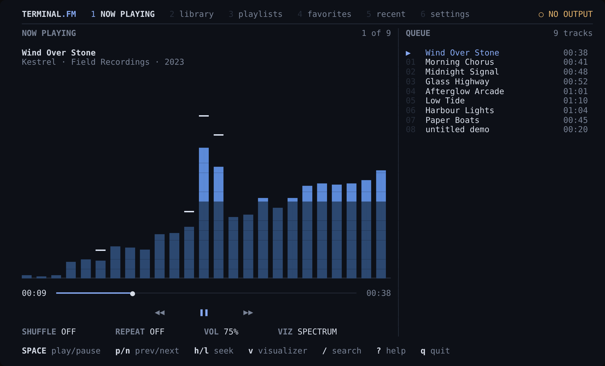
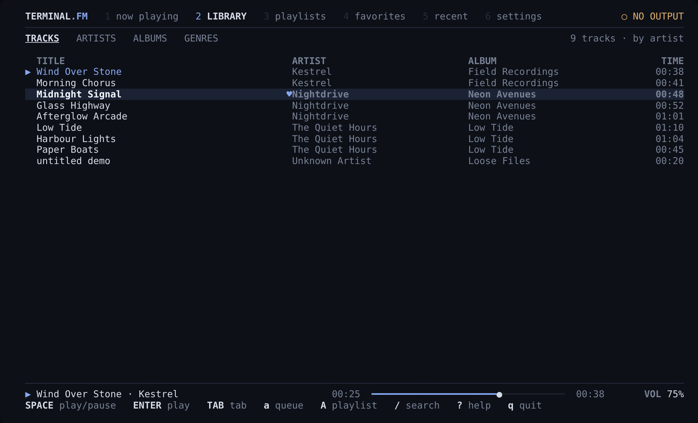
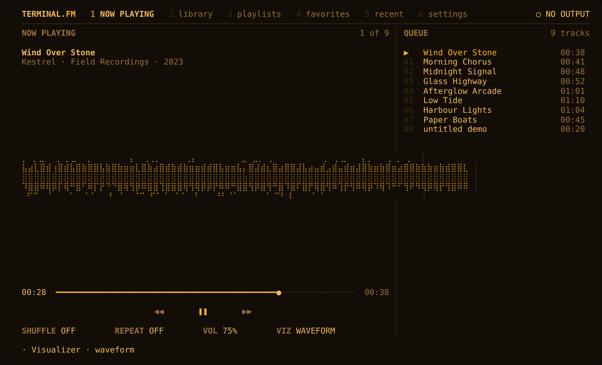
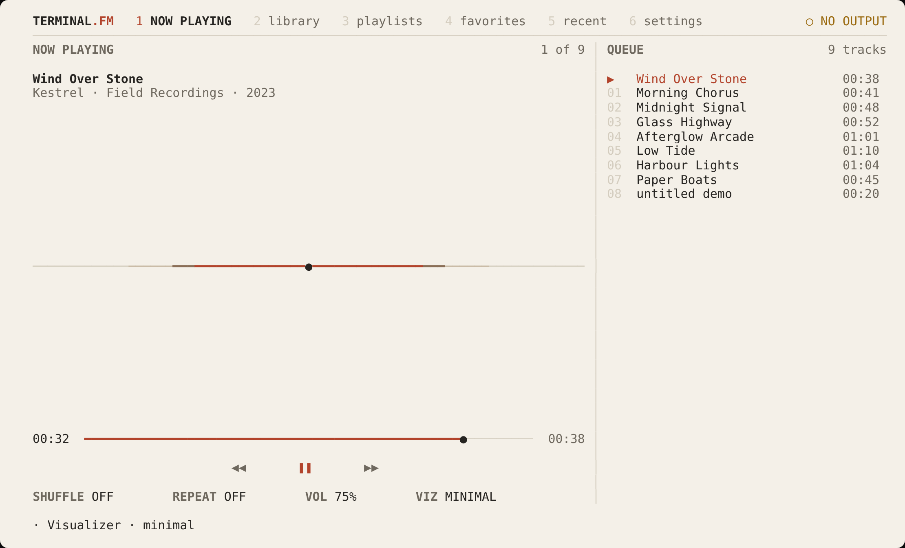
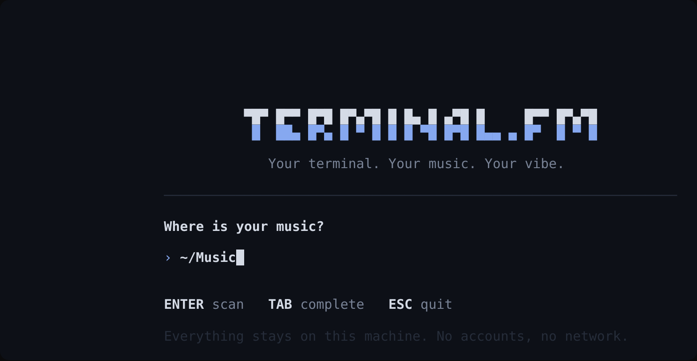

# Terminal.fm

**Your terminal. Your music. Your vibe.**

Terminal.fm is a keyboard-first music player for the terminal, with a real-time
visualizer driven by the audio you're actually hearing. It plays your local files,
works fully offline, and needs no accounts or setup beyond pointing it at a folder.



## Features

- **Plays local files**: MP3, FLAC, WAV, OGG Vorbis and AAC/M4A, decoded natively
  through [symphonia](https://github.com/pdeljanov/Symphonia) via [rodio](https://github.com/RustAudio/rodio).
- **A visualizer that's real.** It reads the same decoded samples that go to your speakers.
  There are three modes plus off:
  - **Spectrum**: Hann-windowed 2048-point FFT, log-spaced bands, peak hold
  - **Waveform**: braille oscilloscope with zero-crossing trigger and adaptive gain
  - **Minimal**: a quiet level line that moves with the music
  - When there are no samples (paused, or nothing arriving), it says so. It never shows made-up motion.
- **Library**: recursive scanning, tag reading ([lofty](https://github.com/Serial-ATA/lofty-rs)),
  browsing by track, artist, album and genre, sorting, and accent-insensitive ranked search.
- **Playlists, favorites and recently played**, all saved locally. If you move or rename a file,
  Terminal.fm finds it again by its tags and duration.
- **Playback**: queue, shuffle, repeat off/all/one, seeking, volume and mute.
- **Four themes** (Mono, Midnight, Amber, Paper) that work in truecolor, 256-color and 16-color terminals.
- **Responsive layout** that adjusts from wide monitors down to a 30×8 terminal. Below that it
  asks you to enlarge the window instead of crashing.
- **Light on resources.** See [Performance](#performance).

| | |
|---|---|
|  |  |
|  |  |

> The screenshots are real captures of the app (`tmux capture-pane` → HTML → PNG), recorded
> without an audio device, which is why the header reads **○ NO OUTPUT**. Braille waveforms
> look slightly uneven in the PNGs because of the browser's font. They line up correctly in a
> terminal.

## Install

You need Rust 1.85 or newer ([rustup.rs](https://rustup.rs)).

```sh
git clone https://github.com/lijnati/Terminal.fm
cd Terminal.fm
cargo install --path .
```

This installs two commands, `terminalfm` and the short alias `tfm`.

**Platform requirements**

| Platform | Audio backend | Extra setup |
|---|---|---|
| Linux | ALSA (also works with PipeWire/PulseAudio through their ALSA plugins) | Debian/Ubuntu: `sudo apt install libasound2-dev pkg-config` · Fedora: `sudo dnf install alsa-lib-devel` · Arch: `sudo pacman -S alsa-lib` |
| macOS | CoreAudio | none |
| Windows | WASAPI | none (use Windows Terminal for full color and Unicode) |

## Usage

```sh
terminalfm                 # launch (the first run asks for your music folder)
terminalfm ~/Music         # add a folder and open it
terminalfm scan            # rescan configured folders from the shell
terminalfm config          # print config, state, cache and log locations
terminalfm --no-audio      # run without opening an audio device
terminalfm --help | --version
```

## Keyboard

Press `?` in the app for the full list. Keys can be remapped in the config file.

| Key | Action | Key | Action |
|---|---|---|---|
| `Space` | play / pause | `j` / `k` | move down / up |
| `n` / `p` | next / previous | `g` / `G` | top / bottom |
| `h` / `l` | seek −/+ 5 s | `Enter` | play / open |
| `+` / `-` | volume | `Esc` | back / close |
| `m` | mute | `Tab` | switch panel / tab |
| `s` | shuffle | `1`–`6` | screens |
| `r` | repeat off → all → one | `/` | search |
| `f` | favorite | `a` / `e` | queue / play next |
| `v` | visualizer mode | `A` | add to playlist |
| `t` | theme | `c` / `R` / `d` | new / rename / delete |
| `x` | stop | `J` / `K` | reorder playlist |
| `?` | help | `q` | quit |

While you type in a text field (search, playlist names, folders), letter keys only type text.
They never trigger playback shortcuts.

Screens: **1** Now Playing · **2** Library · **3** Playlists · **4** Favorites · **5** Recent · **6** Settings.

## Configuration

Run `terminalfm config` to see where the file lives. The defaults are:

- Linux: `~/.config/terminalfm/config.toml`
- macOS: `~/Library/Application Support/terminalfm/config.toml`
- Windows: `%APPDATA%\terminalfm\config\config.toml`

Every option is documented in [`config.example.toml`](config.example.toml). Changes made on the
Settings screen are written back to this file, and rewriting it drops any comments you added.
If the file has an error, Terminal.fm shows the line number, runs with defaults, and **leaves
your file untouched**.

Set `TERMINALFM_HOME=/some/dir` to keep config, state, cache and log together in one folder,
for example a portable install.

Favorites, playlists and history are stored in `state.json`, and the scanned library is cached
in `library.json`. Both are plain JSON and written atomically.

## Supported formats

| Format | Extensions | Verified by |
|---|---|---|
| MP3 | `.mp3` | `tests/formats.rs` (tags, decode, 440 Hz detected by the analyzer) |
| FLAC | `.flac` | same |
| OGG Vorbis | `.ogg`, `.oga` | same |
| AAC (LC) in MP4 | `.m4a`, `.mp4` | same |
| WAV (PCM) | `.wav` | same |

Not supported: ALAC, Opus, WMA, and HE-AAC (untested). Unsupported or corrupt files are skipped
during scanning (and listed in the log). If one fails to play, you get a message and the queue
moves on to the next track.

## How the visualizer works

```
File → symphonia decoder → Tap ─┬─→ Player (pause · volume · seek) → Mixer → audio device
                                └─→ lock-free ring buffer → Analyzer (FFT · envelope · RMS) → renderer
```

`Tap` is a pass-through source placed right after the decoder. It copies each sample into a
bounded single-producer/single-consumer ring buffer. If the UI falls behind, the tap drops
samples instead of ever blocking the audio thread. Because the tap sits before the volume stage,
the visualizer looks the same at any volume.

**Known limitation:** samples are tapped when the audio device pulls them, which is about one
device buffer (typically 10–50 ms) before you hear them. Spectrum bands use a fixed
40 Hz–16 kHz log layout, with a +3 dB/octave tilt so high frequencies stay visible.

## Performance

Measured on the release build in a 4-core Linux container with **no audio device** (null output)
at 120×36, averaged over 10 s windows using `/proc/<pid>/stat`:

| State | CPU (one core) |
|---|---|
| Stopped, idle | 0.9 % |
| Playing, spectrum @ 30 fps | 2.6 % |
| Playing, waveform @ 30 fps | 3.0 % |
| Playing, visualizer off | 1.6 % |
| Paused | 1.1 % |

Resident memory was about 9 MB with a 9-track library. Real device output and larger libraries
will differ, so treat these numbers as a rough guide, not a benchmark.

## Troubleshooting

- **The header says “○ NO OUTPUT”.** No audio device could be opened. Playback and the
  visualizer still run, but nothing is audible. On Linux, check that `aplay -l` lists a device
  and that your user can open it (for example, membership in the `audio` group). The reason is
  logged (see `terminalfm config` for the log path).
- **Colors look wrong.** Set `COLORTERM=truecolor` if your terminal supports it, or choose the
  Mono theme. `NO_COLOR=1` switches to the basic 16 colors.
- **Boxes or blanks where glyphs should be.** Use a font with block-element and braille glyphs,
  such as JetBrains Mono, Iosevka, DejaVu Sans Mono or Cascadia Code.
- **A track is listed as missing.** The file moved or was deleted. Run `terminalfm scan`, and
  entries that match by title, artist, album and duration are re-linked.
- **More detail.** Run with `TERMINALFM_LOG=debug` and check the log file.
- **The terminal looks broken after a crash.** Terminal.fm restores the terminal on normal exit,
  on errors and on panics. If it's killed by `SIGKILL`/`SIGTERM`, it can't clean up, so run `reset`.

## Platform support

| Platform | Status |
|---|---|
| Linux x86_64 | Built and tested: full test suite, plus manual runs in tmux with the null output |
| Linux real audio output | **Not verified.** The development container has no sound device |
| macOS, Windows | **Not verified locally.** CI (`.github/workflows/ci.yml`) builds and tests on both, but no results exist yet |

## Development

See [CONTRIBUTING.md](CONTRIBUTING.md). In short:

```sh
cargo fmt --all -- --check
cargo clippy --all-targets --all-features -- -D warnings
cargo test --all-features
cargo build --release
```

None of the tests need an audio device. The codec tests use small fixtures in `tests/fixtures`.

## License

Dual-licensed under either [MIT](LICENSE-MIT) or [Apache-2.0](LICENSE-APACHE), at your option.
